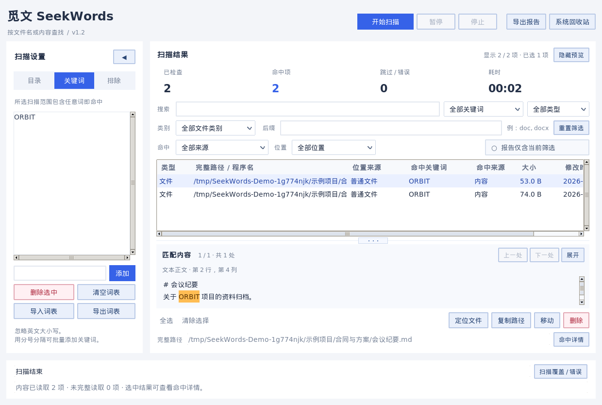
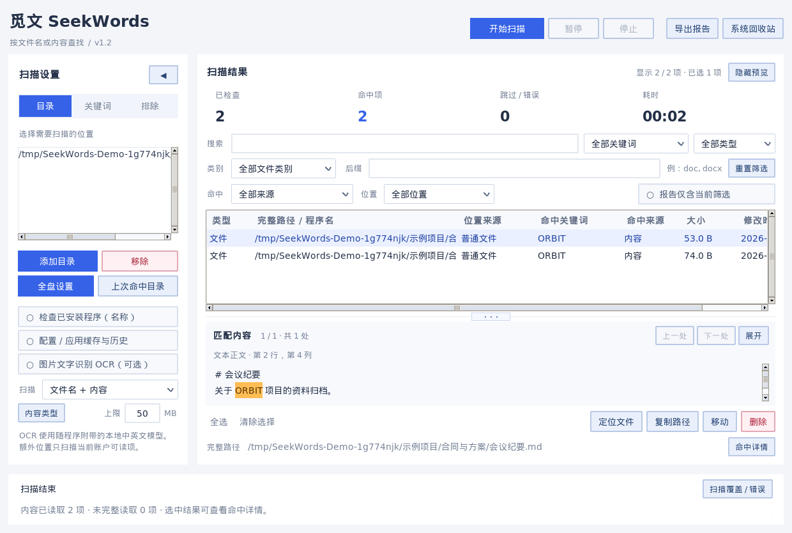

<div align="center">
  
  <h1>觅文 SeekWords</h1>
  <p>在自己的电脑上，按关键词查找文件名和文档内容。</p>
  <p>Windows · Linux · macOS　|　桌面图形界面　|　v1.2</p>
</div>





**首次启动没有内置关键词。** 自己添加关键词、导入 UTF-8 词表，选择一个或多个目录，再点击“开始扫描”。目录、词表和排除项会在本机保存；程序不会自动开始全盘扫描，也不会上传扫描内容。

## 下载与启动

从 [v1.2 发布页](https://github.com/Acczdy/SeekWords/releases/tag/v1.2) 下载适合系统的文件：

| 系统 | 下载 | 启动 |
| --- | --- | --- |
| Windows x64 | `SeekWords-windows-x64.exe` | 双击运行，无需安装 Python；不出现命令窗口 |
| Linux x64 | `SeekWords-linux-x64.tar.gz` | 解压后运行 `SeekWords`，需要图形桌面及系统 Tk 库 |
| macOS Intel | `SeekWords-macos-x64.zip` | 解压后打开 `SeekWords.app` |
| macOS Apple Silicon | `SeekWords-macos-arm64.zip` | 解压后打开 `SeekWords.app` |
| 全平台源码 | 发布页的 Source code，或克隆仓库 | Python 3.10+ 和 Tcl/Tk；见下文 |

安装包由 GitHub Actions 在各自系统上构建。当前发布包没有代码签名或 Apple 公证；macOS 首次打开可能需要在“系统设置 → 隐私与安全”允许此应用。Linux 的图形与系统库兼容性取决于发行版；若独立包无法启动，可按下面的方法运行源码。

### 运行源码

下载源码后，保留 `scan_keywords_app` 与入口脚本在同一目录。解析组件已放在 `scan_keywords_app/_vendor` 中，无需安装 Office；如需在源码模式使用图片 OCR，请运行 `python -m pip install -r requirements-ocr.txt`。Windows 源码运行时如需删除到系统回收站，还需安装 `pywin32`。预编译的安装包已包含 OCR 与回收站组件。

```bash
# Linux / macOS：需要系统提供 tkinter（Ubuntu / Debian 可安装 python3-tk）
python3 seekwords.py

# Windows：双击 seekwords.vbs 可隐藏终端窗口；也可用
py -3 seekwords.py
```

若想预填扫描目录，可以传多个路径，例如 `python3 seekwords.py /path/one /path/two`。这只填入界面，不会自动扫描。

## 主要功能

- **灵活范围**：添加多个目录，一键填入本机磁盘作为全盘扫描设置，排除指定目录，暂停或停止扫描；侧边栏内的按钮可折叠为窄栏，长路径可查看和复制。
- **关键词匹配**：按文件名、内容或两者查找；用户自行维护词表，忽略英文大小写。结果可按完整命中词、命中来源、名称、文件类别和后缀筛选；`Ctrl+F` 或 `⌘F` 可聚焦搜索框。
- **文档内容**：读取可提取文字的 Word、PowerPoint、Excel、PDF、RTF、OpenDocument，以及常见文本与脚本文件；在预览中高亮关键词，显示页码、段落、工作表单元格或文本行列。
- **覆盖与进度**：扫描时显示不带分隔符的已检查数量、结果数、错误数和当前路径；展示已读取、未完整读取、未支持与排除项数量。完整错误逐条保存在本机日志。
- **结果处理**：打开所在目录、复制路径、批量移动、移入系统回收站；删除前统一核对清单。不能回收的项目会报告失败，保留失败项供检查和重试；Linux/macOS 可在另行明确确认后彻底删除。
- **报告**：默认生成可离线查看的 HTML 报告，含摘要、筛选、错误和高亮片段；可选择只导出当前筛选结果，也可导出 CSV、TXT 或 JSON。[查看示例报告](assets/example-report.html)。
- **配置、缓存与打开历史**：可选扫描当前账户常见的 Office/WPS、微信/钉钉、浏览器、系统缓存与最近使用位置；能读取的文本、plist 和 SQLite 数据库参与关键词匹配，并标注来源。位置随系统及应用版本变化，找不到的位置可手动添加目录。
- **Windows 注册表**：可选只读检查 HKCU、HKLM、HKU 的键名、值名及可读取的文字/数字值，结果标为注册表或打开历史、系统痕迹。二进制和无权限项计入覆盖统计，不会修改注册表。
- **回收站与图片 OCR**：额外位置包含 Windows 回收站、macOS 废纸篓和 Linux 用户回收站。Windows 回收站元数据、Linux XDG `.trashinfo` 可读取时展示原路径与删除时间；macOS 废纸篓通常只能显示现有路径。OCR 默认关闭，启用后使用随包提供的本地中英文模型识别 PNG/JPEG/TIFF/BMP 图片，预览中显示命中文字和像素位置。
- **定点复查**：扫描结束时在本机记录最多 500 个命中目录；下次可点击“上次命中目录”填入这些位置，再手动开始扫描。结果可按文件格式、关键词、名称/内容命中和位置来源组合筛选；双击常见文档或图片用默认程序打开，点“定位文件”在文件管理器中查找。

## 扫描范围与限制

“全盘设置”会填入当前检测到的本机磁盘、选择支持的内容类型，并开启配置/缓存及 Windows 注册表选项，**仍需要自己点击开始**。额外来源和 OCR 也可分别手动勾选。文件名模式适用于所有能列出的文件名；内容模式只读取已选且可解析的类型。目录权限不足、文件占用、超限、加密、损坏、符号链接、扫描图片 PDF、压缩包内部及嵌入对象都会影响内容覆盖。不能读取时会记录原因，并继续其他文件；结果不能被解释为磁盘上每个文件的内容都已检查。

内容在本机独立进程中解析，默认单文件上限 50 MB、读取超时 30 秒。大范围内容扫描可能耗时较久。工具不会执行脚本、Office 宏或表格公式；Excel 显示文件中已有的公式缓存值。文本后缀文件如果实际是二进制数据，会标记为未完整读取。

图片 OCR 使用随 Windows、Linux、macOS 安装包提供的 RapidOCR/ONNX 中英文模型，**无需另装 OCR 程序或语言包**。程序先校验模型文件，再从本机直接读取；识别不联网、不上传图片或文字。速度取决于硬件、图片大小和清晰度，不保证每张图片耗时。图片不会按压缩后的二进制字节做关键词匹配；启用 OCR 时仅扫描常见图片格式，不包括扫描版 PDF 的逐页 OCR。手写体和极小文字可能漏识别。模型来源、哈希和许可证见 [OCR 组件说明](docs/OCR_COMPONENTS.md)。

注册表读取不自动申请管理员权限；Windows 界面右上角显示当前权限，可按需使用界面中的管理员启动入口。普通账户下不可访问的键会列为权限错误。此版本检查的是**可读取的注册表文字**，没有解析 USN、事件日志、Prefetch、SRUM、ShellBags、BAM 或 Amcache 的二进制结构；其中可读注册表路径可能以“系统痕迹（注册表）”标注。macOS/Linux 扫描的是本机可访问的文件、配置与缓存，不等同于平台级取证。当前定点复查需手动启动，尚无后台实时监控。

SQLite 使用只读方式读取已写入数据库主文件的文字；尚未合并到主文件的 WAL 内容可能缺失。回收站扫描只读取元数据和可访问文件，不保证每个系统/磁盘都保留原路径；界面中回收站结果为只读，不参与移动或删除操作。缓存可能包含私密资料，导出和分享报告前请自行核对。

移入系统回收站使用操作系统接口，源文件可能因为权限、只读属性、正在使用或回收站不可用而失败。删除操作仅对用户确认过的结果执行；目录包含未命中的子文件，确认界面会明确提醒。移动不覆盖同名文件，跨磁盘移动出现问题时会报告源与目标状态。每项操作前核对路径与扫描时的文件标识，不操作磁盘根、用户主目录或工具自身。

## 从旧版升级

v1.0 使用独立的本机设置目录 `SeekWords`。旧版 `scan-keywords` 的词表不会自动导入，因此不会把旧版默认词带进新版本。如果旧版已有自己维护的词表，可从旧版导出 UTF-8 词表，再在本版点击“导入词表”。旧版程序正在扫描时，可以让它完成后再关闭。

## 开发与构建

```bash
python3 -m unittest discover -s tests -p "test_*.py"
python -m pip install -r requirements-build.txt
python scripts/build.py
```

PyInstaller 需要在目标操作系统上运行；对应的 GitHub 构建流程在 [release.yml](.github/workflows/release.yml)。具体打包步骤见 [构建说明](docs/BUILDING.md)。本项目源码采用 [MIT License](LICENSE)；随包附带的解析及回收站组件保留各自许可证，见 `scan_keywords_app/_vendor`。
